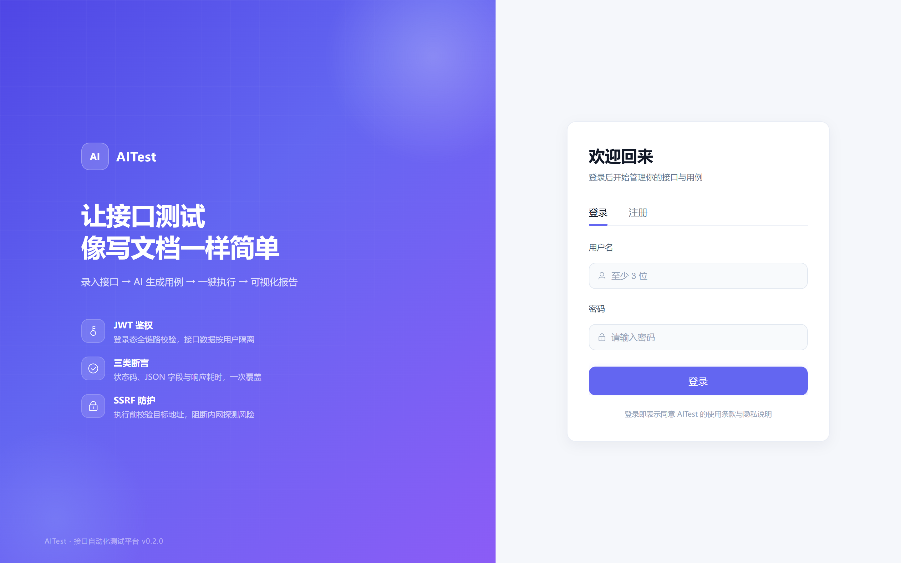
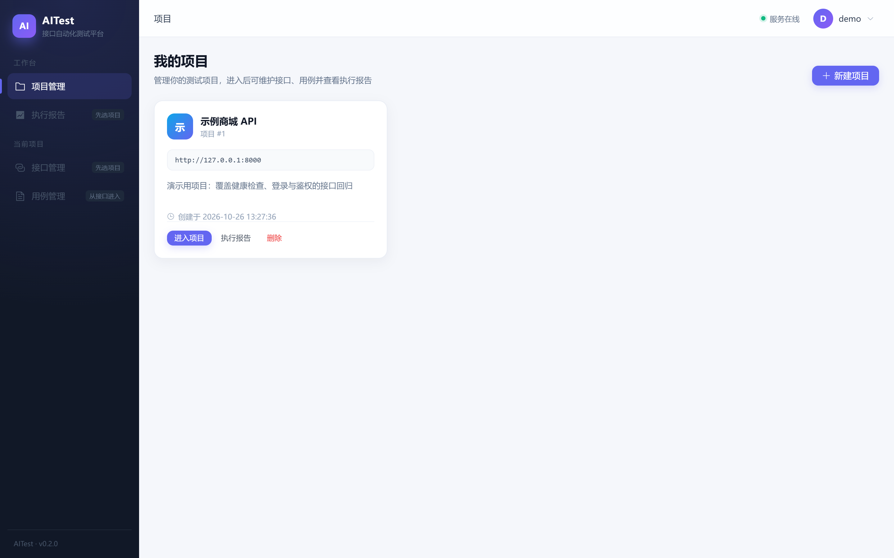
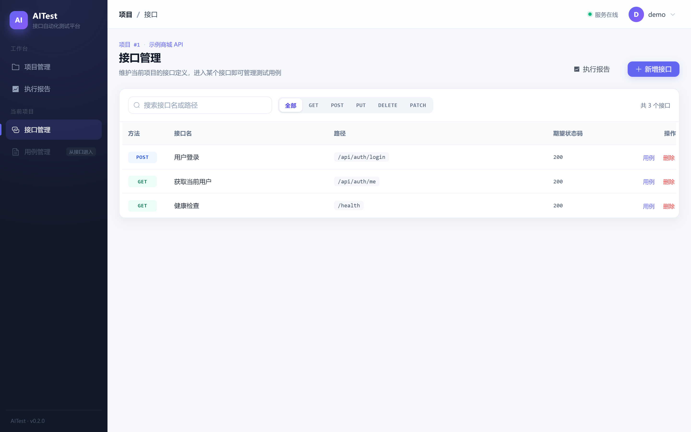
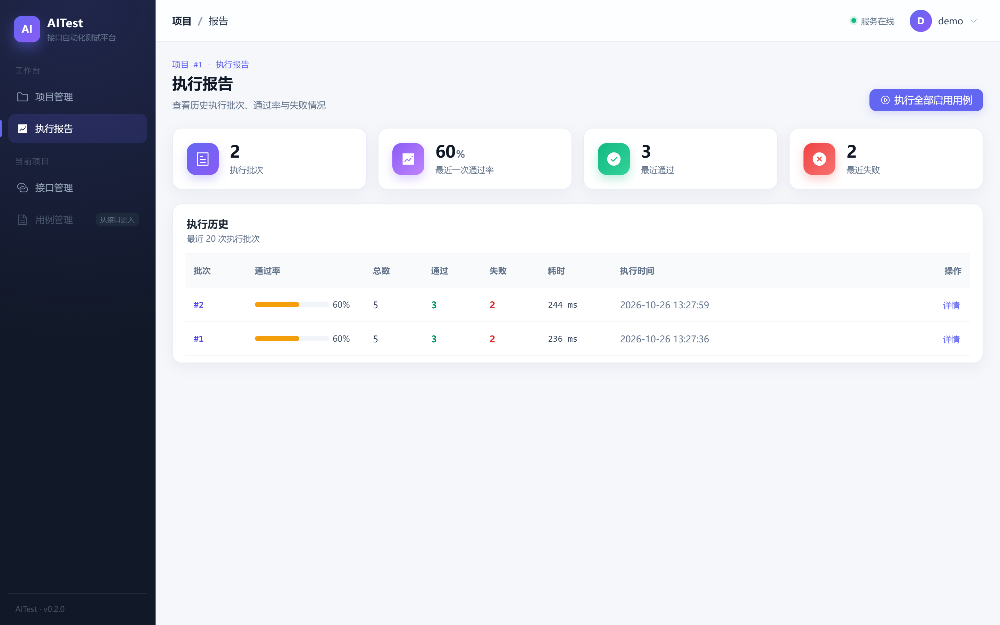
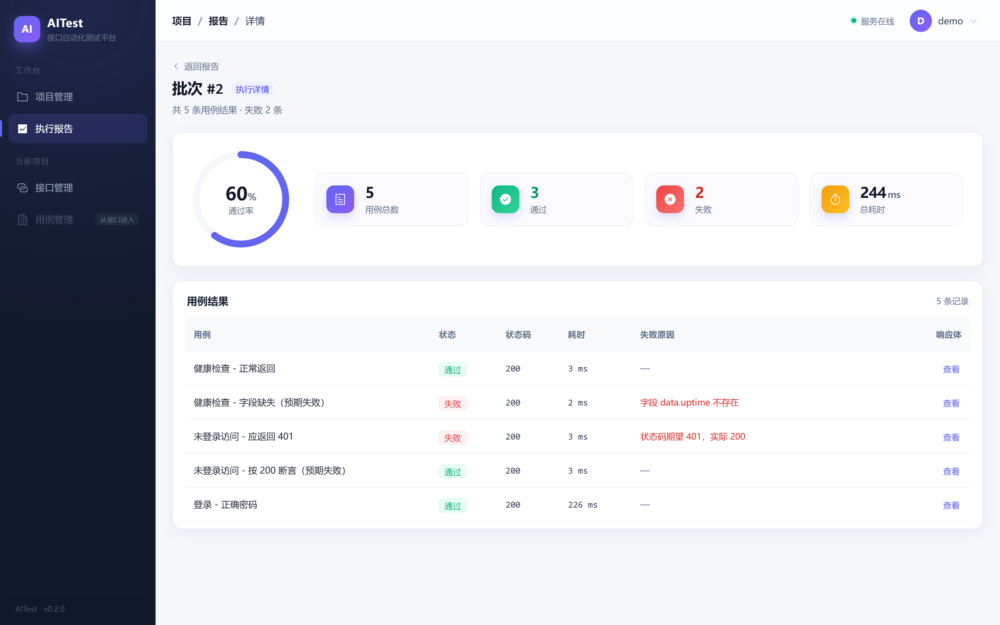
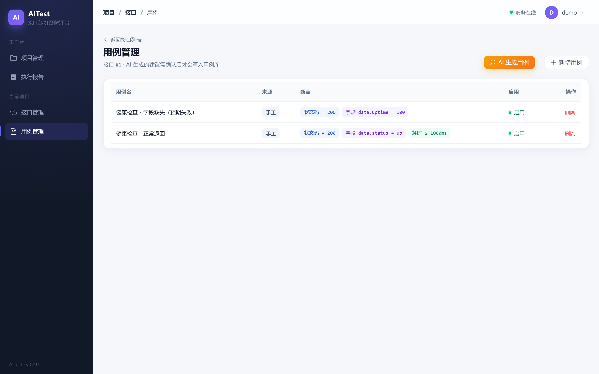

# AITest · 轻量接口自动化测试平台

[](https://github.com/Recce999/AiTest/actions/workflows/ci.yml)

录入接口定义 → AI 生成测试用例 → 一键执行 → 可视化报告。

## 界面预览

| 登录 | 项目管理 |
| --- | --- |
|  |  |

| 接口管理 | 执行报告 |
| --- | --- |
|  |  |

| 报告详情 | 用例与断言 |
| --- | --- |
|  |  |

界面风格：深色侧边栏 + 靛蓝紫主色（`#6366F1`）；统一卡片、状态色与空状态，通过率环形进度、方法分段筛选、断言 chip、响应体抽屉等细节均按「单页单主操作」原则组织。

## 技术栈

| 层 | 选型 | 理由 |
| --- | --- | --- |
| 后端 | FastAPI + SQLAlchemy 2 + Pydantic v2 | 轻量、自带 OpenAPI 文档、代码量小 |
| 数据库 | SQLite（开发）→ PostgreSQL（部署） | 零配置起步，上线只改连接串 |
| 认证 | JWT + bcrypt | 无状态、部署简单 |
| 前端 | Vue3 + Vite + Element Plus + Pinia | 当前主流组合，组件齐全 |
| 部署 | Docker 多阶段镜像 | 前端打包后由后端托管，前后端同源，可跑在任意容器平台 |

## 功能

- 注册 / 登录 / JWT 鉴权
- 项目、接口、用例三级管理（越权校验）
- 执行引擎：HTTP 请求 + 三类断言（状态码 / JSON 字段 / 响应耗时）
- 执行报告：通过率、失败原因、响应快照、历史记录
- 用例页多选批量执行：只跑勾选的用例，执行后直接跳转报告详情
- AI 生成用例：大模型输出 + 结构校验，人工确认后入库；无密钥自动回退规则模板
- SSRF 防护：默认拦截内网目标（开发期可用开关放行）

## 目录结构

```text
aitest/
├── backend/
│   ├── app/
│   │   ├── main.py              # 入口：路由装配、CORS、异常、日志、建表、托管前端
│   │   ├── api/                 # 路由层（只做参数校验与转发）
│   │   ├── core/                # 配置、数据库、安全、异常、日志
│   │   ├── models/              # 六张表
│   │   ├── schemas/             # 请求/响应校验
│   │   └── services/            # 业务层（认证、执行引擎、AI 生成、权限）
│   ├── tests/                   # pytest 用例（30 个）
│   ├── requirements.txt
│   ├── requirements-dev.txt
│   └── .env.example
├── frontend/                    # Vue3 + Vite + Element Plus
├── assets/screenshots/          # README 界面截图
├── .github/workflows/ci.yml     # 后端测试 + 前端构建
├── Dockerfile                   # 多阶段构建：Node 构建前端 → Python 运行后端
├── BUGFIX.md                    # 缺陷记录：现象、根因、修复、验证
└── docs/                        # 设计说明书、手册、练习单（本地资料，未入库）
```

## 本地启动

### 后端

```bash
cd backend
python -m venv .venv
source .venv/bin/activate          # Windows: .venv\Scripts\activate
pip install -r requirements.txt
uvicorn app.main:app --reload
```

验证：`curl http://127.0.0.1:8000/health` → `{"code":0,...}`；文档 <http://127.0.0.1:8000/docs>

### 前端

```bash
cd frontend
npm install
npm run dev
```

打开 <http://localhost:5173>，注册后登录。

> 生产构建 `npm run build` 产出 `frontend/dist`，后端启动时会自动托管该目录，前后端同源。

## 测试与 CI

```bash
cd backend
pip install -r requirements-dev.txt
python -m pytest
```

- 26 个用例覆盖：健康检查、认证与越权、项目/接口/用例 CRUD、AI 生成建议不落库、执行引擎（假响应替换真实 HTTP）、SSRF 拦截、批量执行、执行历史与报告详情、删除项目时清理执行记录。
- 测试使用临时 SQLite，每个用例执行前重建表，互不污染。
- GitHub Actions 同时执行后端 pytest 与前端 `npm run build`。
- 开发与自测中发现并修复的缺陷记录在 [BUGFIX.md](BUGFIX.md)。

## 部署

### Docker

```bash
docker build -t aitest .
docker run -p 8000:8000 -e JWT_SECRET="$(python -c 'import secrets;print(secrets.token_hex(32))')" aitest
```

访问 <http://127.0.0.1:8000>，前端、接口、文档由同一个容器提供。镜像可直接部署到任意容器平台（Railway / Fly.io / Koyeb）或云服务器 + Docker Compose。

生产环境有两点必须确认：

- **数据库**：默认使用容器内 SQLite，容器重建会清空数据；需要持久化就把 PostgreSQL 的连接串填进 `DATABASE_URL`（Neon、Supabase 等提供免费额度）；
- **安全**：务必设置 `ALLOW_PRIVATE_TARGET=false`，让执行引擎拦截内网目标。

## 配置

所有配置项见 [`backend/.env.example`](backend/.env.example)，复制为 `backend/.env` 后修改即可：

| 配置项 | 默认值 | 说明 |
| --- | --- | --- |
| `DATABASE_URL` | `sqlite:///./aitest.db` | 数据库连接串，支持 PostgreSQL |
| `JWT_SECRET` | `change-me-in-production` | 生产必改，至少 32 字节随机串 |
| `ALLOW_PRIVATE_TARGET` | `True` | 生产必须为 `False`，拦截内网目标 |
| `REQUEST_TIMEOUT` | `5` | 单次请求超时（秒） |
| `LLM_API_KEY` | 空 | 留空则 AI 生成走规则模板 |

## 接口一览

| 方法 | 路径 | 说明 |
| --- | --- | --- |
| GET | /health | 健康检查 |
| POST | /api/auth/register | 注册 |
| POST | /api/auth/login | 登录 |
| GET | /api/auth/me | 当前用户 |
| GET/POST | /api/projects | 项目列表 / 新建 |
| PUT/DELETE | /api/projects/{id} | 更新 / 删除 |
| GET/POST | /api/apis | 接口列表 / 新建 |
| PUT/DELETE | /api/apis/{id} | 更新 / 删除 |
| GET/POST | /api/cases | 用例列表 / 新建 |
| PUT/DELETE | /api/cases/{id} | 更新 / 删除 |
| POST | /api/cases/ai-generate | AI 生成用例建议 |
| POST | /api/runs | 触发执行 |
| GET | /api/runs | 执行历史 |
| GET | /api/runs/{id} | 报告详情 |

## 开发约定

1. 所有接口返回 `{code, msg, data}`，`code=0` 表示成功；
2. 业务错误抛 `BizError`，不写 `try/except` 兜底；
3. 路由层不写业务逻辑，业务进 `services/`；
4. 配置只从 `core/config.py` 读，禁止硬编码；
5. 任何按 id 查数据的地方，都要走 `services/access.py` 校验归属。

## 断言格式

```json
[
  {"type": "status_code", "expected": 200},
  {"type": "json_field", "path": "data.status", "expected": "up"},
  {"type": "max_duration", "expected": 1000}
]
```
